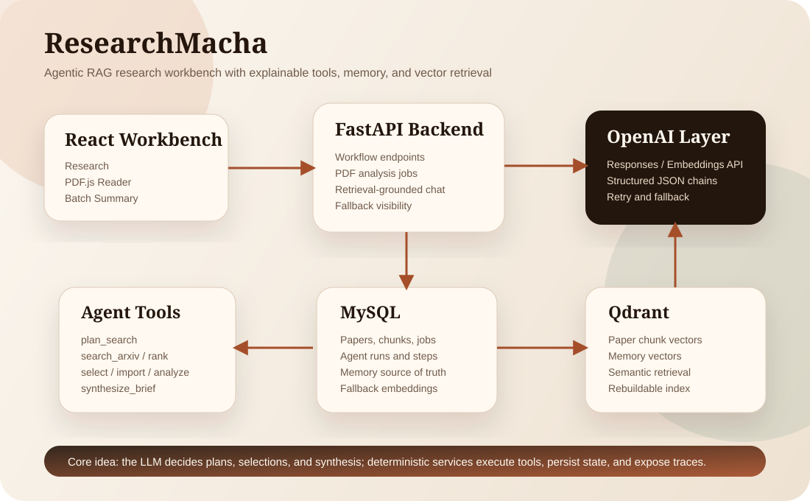
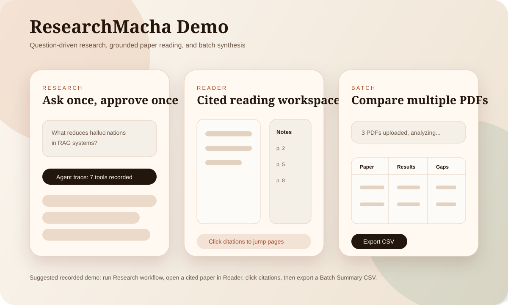

# ResearchMacha


ResearchMacha is a local-first research helper system for turning a research question into relevant papers, cited paper notes, cross-paper findings, and suggested next experiments.

It is built as a portfolio-grade MVP around explainable agentic RAG: LLMs handle planning, paper selection, and synthesis; deterministic backend tools handle search, import, parsing, indexing, and persistence.



## Core Workflows

- `Research`: type one research question, let the backend plan/search/select papers, approve the selected papers, then receive a cited research brief with findings, gaps, experiments, and research directions. Reopen saved questions from `Projects`; naming a project or saving a selection does not start processing.
- `Reader`: upload or open one PDF, read it in a PDF.js viewer beside structured notes, cited highlights, and grounded chat. Conversations and reading position are saved per paper; an explicit citation page takes precedence when opening a source link.
- `Compare`: upload two to ten PDFs and get a saved comparison covering main idea, problem/hypothesis, experiments, models/datasets, results, and conclusions. The backend worker finishes processing after the tab closes. Reopening or saving edited details does not generate again; use `Update comparison` explicitly to replace a result.

Saved projects use `/projects/{project_id}` and comparisons use `/comparisons/{comparison_id}`. These URLs reopen the local workspace's stored data; they are not public sharing links. Run the additive Alembic upgrade below when updating an existing checkout. Older comparison tables that existed only in browser state cannot be recovered.



## Stack

- Frontend: React, Vite, TypeScript, React Router, PDF.js
- Backend: FastAPI, SQLAlchemy, Alembic, MySQL
- Model layer: native OpenAI SDK, Responses API, strict structured outputs
- AI providers: `openai` (default) and `mock` (offline fixtures)
- Generation: `gpt-6-luna`, reasoning `none`; embeddings: `text-embedding-3-small`
- Vector retrieval: Qdrant by default with MySQL JSON cosine similarity as fallback
- Memory: MySQL source-of-truth rows indexed into Qdrant for semantic recall, with MySQL fallback

## Repository Layout

```text
.
|-- backend
|   |-- alembic
|   |-- app
|   |-- scripts
|   `-- tests
|-- docs
|   |-- assets
|   |-- architecture.md
|   |-- demo.md
|   |-- showcase.md
|   |-- testing-checklist.md
|   `-- walkthrough.md
`-- frontend
    `-- src
```

## Quickstart

### 1. Configure Environment

Copy `.env.example` to the repository-root `.env` if it does not already exist. Set your MySQL credentials and backend-only `OPENAI_API_KEY`. If `DATABASE_URL` is set, it takes precedence over the separate MySQL settings. Never put the key in a `VITE_` variable or commit `.env`.

Recommended local settings:

```env
MYSQL_HOST=127.0.0.1
MYSQL_PORT=3306
MYSQL_USER=root
MYSQL_PASSWORD=your-password
MYSQL_DATABASE=research_macha

AI_PROVIDER=openai
OPENAI_API_KEY=your-api-key
OPENAI_MODEL=gpt-6-luna
OPENAI_EMBED_MODEL=text-embedding-3-small
OPENAI_REASONING_EFFORT=none

VECTOR_PROVIDER=qdrant
QDRANT_URL=http://localhost:6333
QDRANT_COLLECTION=research_macha_chunks
QDRANT_MEMORY_COLLECTION=research_macha_memories
```

Create the database:

```sql
CREATE DATABASE research_macha;
```

Python 3.12+, Node.js 22+, MySQL, and Docker for Qdrant are required. OpenAI access requires an API key and billing credit. [OpenAI setup and development reset](docs/openai-setup.md) covers the provider switch, optional cleanup, credit controls, and troubleshooting. Ollama is no longer required.

### 2. Start Qdrant

```powershell
docker compose up -d qdrant
```

### 3. Start Backend

```powershell
cd backend
python -m venv .venv
.\.venv\Scripts\python.exe -m pip install -e ".[dev]"
.\.venv\Scripts\python.exe -B -m alembic upgrade head
# For an existing checkout switching providers, see the one-time reset instructions first.
.\.venv\Scripts\python.exe -B -m uvicorn app.main:app --reload --port 8000
```

### 4. Start Frontend

```powershell
cd frontend
cmd /c npm ci
cmd /c npm run dev
```

Open:

```text
http://localhost:5173
```

## Demo Commands

Seed a demo research project with known arXiv candidates:

```powershell
cd backend
.\.venv\Scripts\python.exe scripts\seed_demo.py
```

Run checks:

```powershell
cd backend
.\.venv\Scripts\python.exe -B -m pytest -p no:cacheprovider

cd ..\frontend
cmd /c npm test -- --run
cmd /c npm run build
```

Automated backend tests force mock mode, remove the API key from their process, disable the worker, and reject external HTTP. They do not evaluate the real model or spend OpenAI credits. Using the application with `AI_PROVIDER=openai` does incur usage; no live model evaluation was run for this migration.

## What Makes This Agentic

ResearchMacha uses explicit backend tools instead of a vague autonomous agent. Each workflow records tool inputs, outputs, status, and fallbacks.

Tool steps:

- `plan_search`
- `search_arxiv`
- `rank_candidates`
- `select_candidates`
- `import_papers`
- `analyze_papers`
- `synthesize_brief`

This makes the agent behavior inspectable in the UI and queryable in MySQL.

## Documentation

- [Product specification](docs/product-spec.md): intended researcher experience, feature requirements, and completion criteria.
- [OpenAI setup](docs/openai-setup.md): model settings, optional development reset, credit controls, and startup commands.
- [Showcase](docs/showcase.md): portfolio explanation of agentic RAG, tool use, memory, and vector retrieval.
- [Architecture](docs/architecture.md): system architecture and data flow.
- [Walkthrough](docs/walkthrough.md): demo script and visual assets.
- [Demo](docs/demo.md): local demo setup and troubleshooting.
- [Testing checklist](docs/testing-checklist.md): acceptance checks before final refinement.

## Known Limitations

- Discovery is limited to arXiv.
- PDFs must be born-digital; OCR is not included.
- Import, analysis, and synthesis run through a database-leased worker in the FastAPI process. Use one backend process; multiple API workers are unsupported.
- Application state and PDFs remain local, but prompts and document text used for generation/embeddings are sent to OpenAI. This is not offline inference.
- New model quality and live workflow latency still require user testing. The app never upgrades to a more expensive model automatically.
- The app is single-user and local-first; no hosted auth is included.
- Memory is intentionally simple and becomes useful after repeated workflows.
