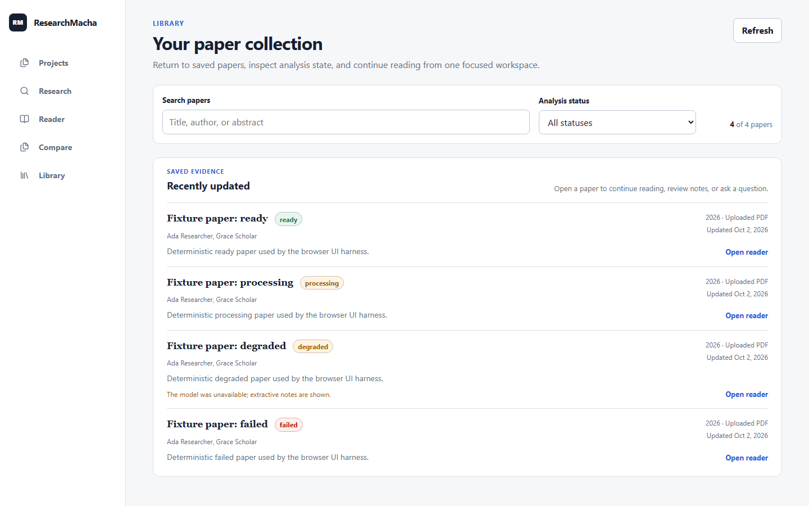
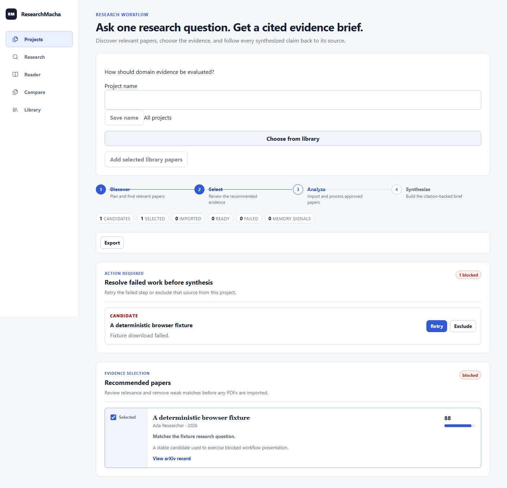
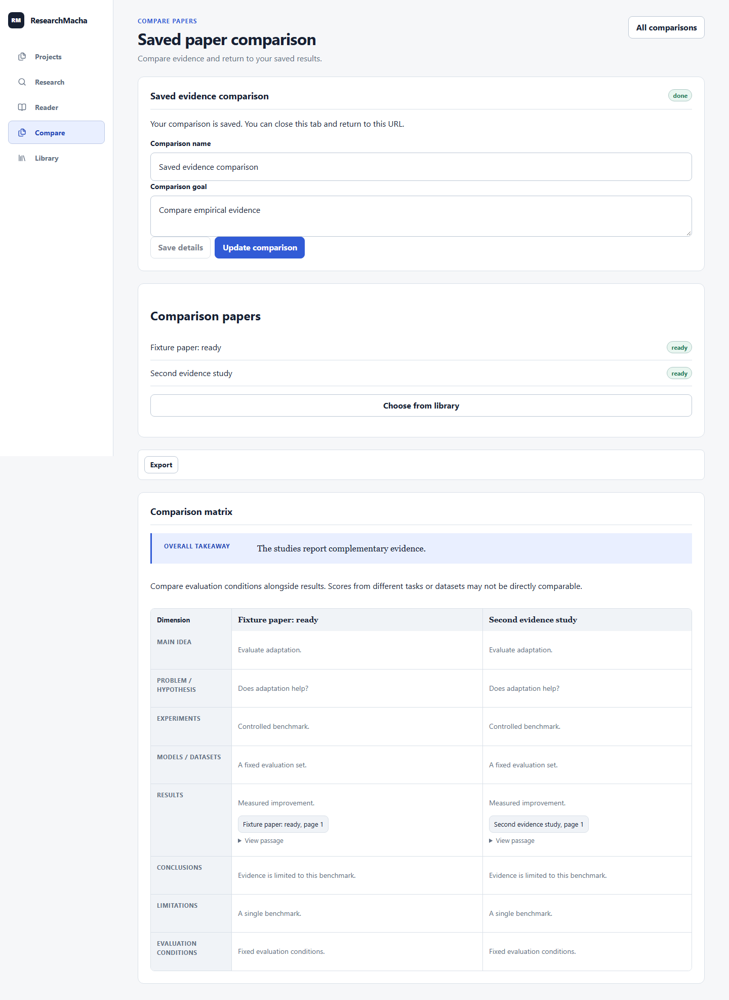
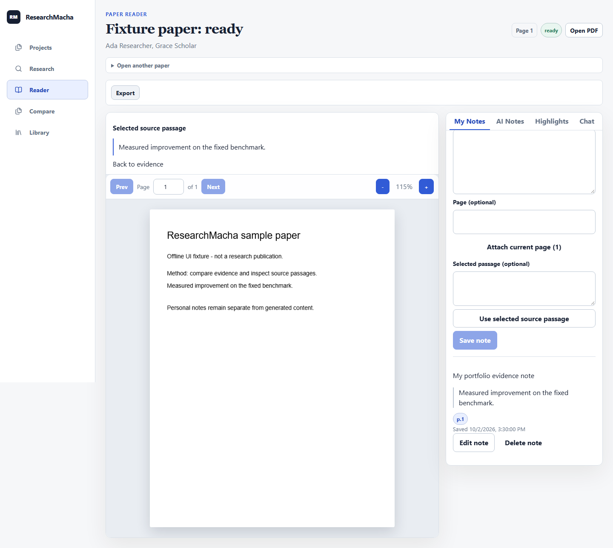

# Portfolio walkthrough and screenshots

These screenshots are reproducible offline UI fixtures, not real research findings or evidence of model quality. The sample PDF says it is a demonstration fixture. Real-paper testing should be recorded separately.

## Screens

### Saved paper library

### Research blockers and recovery

### Saved evidence comparison

### Reader, personal notes and export

## Capture the same UI examples

From the frontend directory, with installed Chromium:

~~~powershell
$env:CAPTURE_DOCS_SCREENSHOTS='1'
cmd /c npm run test:e2e -- --project=chromium-1440
$env:CAPTURE_DOCS_SCREENSHOTS=$null
~~~

The test server intercepts API requests with fixtures. It does not start a paid backend or use developer uploads. Images are written under docs/assets/. Browser downloads use temporary test storage.

## A real demonstration

1. Use one already-processed paper from Library to minimize fresh API use.
2. Show its PDF, one checked source passage and a grounded chat follow-up.
3. Save a personal critique and reopen the paper to recover it and its reading position.
4. Reuse two papers in a comparison with a concrete evaluation goal.
5. Show limitations/evaluation conditions before discussing numerical results.
6. Reopen a saved research project through Projects and inspect its cited brief.
7. Export Markdown with one selected personal note, BibTeX references and comparison CSV.
8. Demonstrate Retry/Exclude using controlled offline fixtures rather than intentionally failing paid model calls.

Describe model-generated interpretation, quoted evidence and personal thinking separately. Do not present proposed experiments as studies that the cited paper already performed.

See [architecture](architecture.md), [engineering decisions](engineering-notes.md) and [workflow instructions](demo.md).
